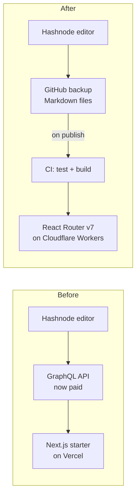
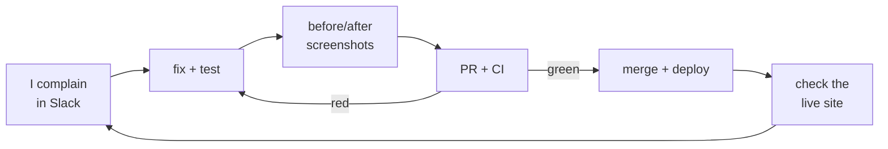
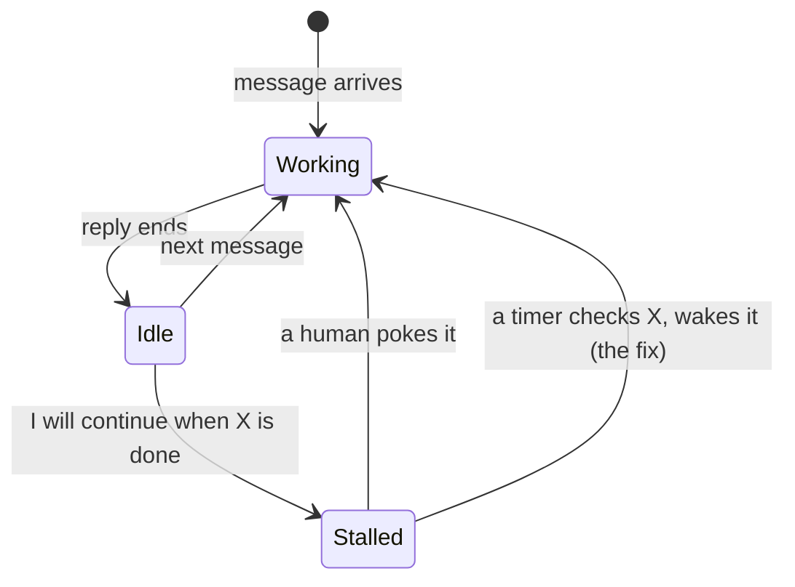

**TL;DR:** In about 21 hours this blog moved from a Hashnode headless starter on Vercel to React Router v7 on Cloudflare Workers. That took 27 pull requests, each one green on CI, plus a production DNS switch. My job was typing opinions into Slack. My AI assistant did the rest. Most of it was impressive. Some of it taught me, the hard way, how to build a better harness.

---

## Why Move at All?

The old site worked fine.

Then Hashnode put its GraphQL API behind a Pro plan.

My blog read every post through that API.

So the choice was simple:

1. Pay a monthly fee to read my own writing.
2. Stop depending on the API.

I picked option 2. My wallet approved ;)))

The trick: Hashnode already backs up every post to a GitHub repo as Markdown. That backup is a perfectly good content source. I keep writing on Hashnode, and the site builds from the backup.

---

## The Setup

The assistant is Jarvis, a Slack bot I built.

Under the hood, each Slack thread gets its own Claude Code session on my Mac. So it isn't just a chat window. It has a real shell, git, and a browser it can click through.

I gave it the job from my phone, then set a few rules:

1. **Every phase is a pull request.** CI must be green. No pushing to `main`.
2. **Tests first on the core logic.** Parsing, read time, pagination, RSS, sitemap.
3. **Keep the architecture light.** A small domain layer, yes. Enterprise layers on top of React Router, no. A route is already the controller.
4. **Open-source quality.** README, ADRs, changelog, licenses.
5. **Report back.** Status after every PR, screenshots after every step.

The plan was eight phases. Then came the part where I scrolled the site on my phone and complained.

```mermaid
flowchart LR
    P0[0. Bootstrap<br/>+ CI] --> P1[1. Content from<br/>GitHub backup]
    P1 --> P2[2. Domain layer]
    P2 --> P3[3. Markdown<br/>at build time]
    P3 --> P4[4. Routes<br/>+ design]
    P4 --> P5[5. SEO, RSS,<br/>OG images]
    P5 --> P6[6. Dark mode<br/>+ search]
    P6 --> P7[7. URL parity,<br/>perf, a11y]
    P7 --> P8[8. Docs, deploy,<br/>DNS cut-over]
    P8 --> F[Me, nitpicking<br/>from my phone]
    F --> F
```

---

## The Wow Parts

### 1\. It respected the process

27 pull requests. Every one passed CI before merge.

For the big ones, a second agent reviewed the branch on its own, ran the tests and left findings on the PR. Blockers were fixed before merge.

Honestly, it followed the process better than some humans I've worked with. No names. You know who you are =)))

### 2\. The numbers aren't just vibes

- **Lighthouse (mobile) performance:** from **44-64** up to **95-96**. Accessibility, best practices and SEO all hit 100.
- **URL parity:** a test checks all 100 working URLs from the old site against the new build. None of them break.
- **Tests:** around 200 unit tests and 168 integration tests running against the built Worker.

### 3\. It did the DNS cut-over itself

I was logged in to Cloudflare and Vercel in my browser.

Jarvis clicked through both dashboards:

- pointed the domain to the new Worker
- deleted the old record pointing to Vercel
- removed the domain from Vercel, but kept the old project around for rollback
- wrote it all down in a docs PR

Usually I'm the one who forgets that last step.

### 4\. The hover preview

I asked for "a fancy preview when you hover a card".

What I got:

- a live preview of the real post next to the cursor
- scroll past half of it and the full post opens **at the same reading position**, with a zoom transition
- analytics events for preview reads, never counted as page views

Then I said the header flashed for a split second inside the preview. It fixed it, then took a snapshot of the preview every 30 ms while it opened, to prove the header never showed up.

I would not have checked every 30 ms. I would have squinted at it once and called it done.

### 5\. Feedback from the couch

Most of the afternoon went like this:

"border blue lúc hover card nhìn xấu điên"

(Vietnamese for "that blue hover border is hideous")

Ten minutes later I had a PR, before/after screenshots, CI passing, a merge, and a check on the live site.

---

## The Not-So-Wow Parts

Most of these aren't about the model. They're about the harness around it. I built that harness, so this section is partly about me =))

### 1\. Agents don't wait. They stop.

A chat-driven agent only works while it's replying to a message. Once the reply ends, nothing is running.

My harness also kills a step after about 15 minutes, a limit I set myself long ago so a stuck step can't burn hours. Plain Claude Code doesn't have that limit. My setup does.

Put those two together and you get the classic stall:

- the agent starts a reviewer in the background
- it ends its turn to "wait for it"
- the review finishes
- nobody wakes the agent up

One PR sat like that for **1.6 hours**. My messages from that stretch are a mood:

"why does it stand idle for so long??"

"why no updates? too slow !!"

**Lesson for harness builders:** "I'll do it once CI finishes" is a promise nobody is around to keep. Give your agent a way to schedule a wake-up that runs outside the conversation: poll whatever it's waiting on, then hand control back. Also keep each step well under any timeout you set.

### 2\. Two writers, one repo

Early on, an agent I thought I'd stopped was still running. Two sessions wrote to the same folder and overwrote each other's files. Phase 0 had also gone straight to `main`.

Fix: kill everything but one, reset `main`, and redo phase 0 as PR #1.

**Lesson:** one agent per repo, and make "is something else already writing here?" a check your harness runs, not something you hope for.

### 3\. Confident, then wrong

A few highlights from cut-over day alone:

- It announced the deploy was live because the page contained a certain string. That string is also in the Google Analytics snippet. It wasn't live.
- It broke CI twice in an hour, both times by tripping its own tests. Once it even wrote a code comment containing the exact text its new test banned. Galaxy brain ;))
- It killed my local dev server, then couldn't start it again, because `node` in its shell was really Bun's Node shim.

Each one was caught within minutes, mostly by Jarvis itself. But "verify before you announce" had to be learned more than once.

**Lesson:** when you check a deploy, look for something only the new build can have.

### 4\. Taste is still mine

Page names, colors, "no, remove the card". All my calls. As they should be.

After I renamed one page three times in five minutes, it stopped auto-merging and started asking first. Smart move. Annoying, but smart ;)

---

## Takeaways

**Keep:**

- PR per phase, CI as a hard gate
- an independent reviewer agent
- screenshots after every step, so you can review from your phone

**Change, if you're building your own harness:**

- give the agent a scheduled wake-up instead of trusting it to remember
- keep steps short, well below your own timeouts
- one writer per repo, enforced
- for anything that's purely taste, ask a human before merging

---

## Final Thoughts

The blog you're reading right now is the result. It's faster. It doesn't need a paid API. Every change has a PR behind it.

The biggest lesson wasn't about React Router or Workers:

**An agent is only as reliable as the loop around it.**

Give it a process and it's excellent. Leave it waiting with nothing to wake it up, and it will happily take a 1.6-hour nap.

Same as people, honestly. Just faster at everything else =)))

---

Written by J., reviewed by Kai.