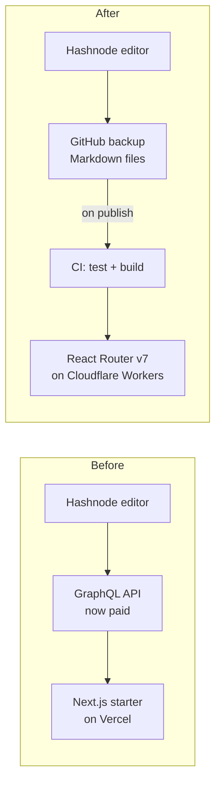
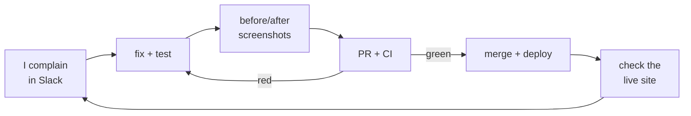
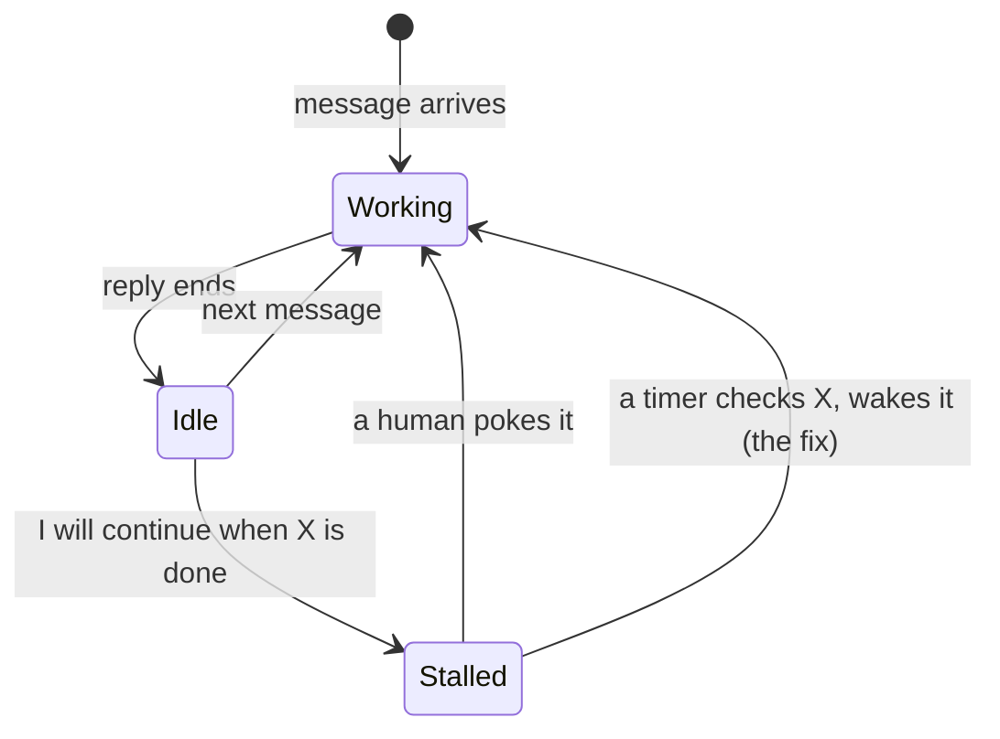

**TL;DR:** In about 21 hours this blog moved from a Hashnode headless starter on Vercel to React Router v7 on Cloudflare Workers. That took 27 pull requests, each one green on CI, plus a production DNS switch. My job was typing opinions into Slack. My AI assistant did the rest. Most of it was impressive. Some of it showed me exactly where my harness is weak.

* * *

## Why Move at All?

The old site worked fine.

Then Hashnode put its GraphQL API behind a Pro plan.

My blog read every post through that API.

So the choice was simple:

1. Pay a monthly fee to read my own writing.
2. Stop depending on the API.

I picked option 2. My wallet approved ;)))

The trick: Hashnode already backs up every post to a GitHub repo as Markdown. That backup is a perfectly good content source. I keep writing on Hashnode, and the site builds from the backup.

* * *

## The Setup

The assistant is Jarvis, a Slack bot I built.

Under the hood, each Slack thread gets its own Claude Code session on my Mac. So it isn't just a chat window. It has a real shell, git, and a browser it can click through.

I gave it the job from my phone, then set a few rules:

1. **Every phase is a pull request.** CI must be green. No pushing to `main`.

2. **Tests first on the core logic.** Parsing, read time, pagination, RSS, sitemap.

3. **Keep the architecture light.** A small domain layer, yes. Enterprise layers on top of React Router, no. A route is already the controller.

4. **Open-source quality.** README, ADRs, changelog, licenses.

5. **Report back.** Status after every PR, screenshots after every step.

The plan was eight phases. Then came the part where I scrolled the site on my phone and complained.

```mermaid
flowchart LR
    P0[0. Bootstrap<br/>+ CI] --> P1[1. Content from<br/>GitHub backup]
    P1 --> P2[2. Domain layer]
    P2 --> P3[3. Markdown<br/>at build time]
    P3 --> P4[4. Routes<br/>+ design]
    P4 --> P5[5. SEO, RSS,<br/>OG images]
    P5 --> P6[6. Dark mode<br/>+ search]
    P6 --> P7[7. URL parity,<br/>perf, a11y]
    P7 --> P8[8. Docs, deploy,<br/>DNS cut-over]
    P8 --> F[Me, nitpicking<br/>from my phone]
    F --> F
```

* * *

## The Wow Parts

### 1. It respected the process

27 pull requests. Every one passed CI before merge.

For the big ones, a second agent reviewed the branch on its own, ran the tests and left findings on the PR. Blockers were fixed before merge.

It followed the process better than some humans I've worked with. No names. You know who you are =)))

### 2. The numbers

- **Lighthouse (mobile) performance:** from **44-64** up to **95-96**. Accessibility, best practices and SEO all hit 100.
- **URL parity:** all 100 URLs the old site served still answer on the new build, checked by a test in CI.

### 3. It did the DNS cut-over itself

I was logged in to Cloudflare and Vercel in my browser.

Jarvis clicked through both dashboards, using my logged-in sessions:

- pointed the domain to the new Worker
- deleted the old record pointing to Vercel
- removed the domain from Vercel, but kept the old project around for rollback
- wrote it all down in a docs PR

Usually I'm the one who forgets that last step. In hindsight, the custom domain should have been one reviewable line in the Wrangler config instead of clicks in a dashboard. More on shared browsers below.

### 4. The hover preview

I asked for "a fancy preview when you hover a card".

What I got:

- a live preview of the real post next to the cursor
- scroll past half of it and the full post opens **at the same reading position**, with a zoom transition
- analytics events for preview reads, never counted as page views

Then I said the header flashed for a split second inside the preview. It fixed it, then captured a frame every 30 ms while the preview opened. The header wasn't in any of them.

I would have squinted at it once and called it done.

### 5. Feedback from the couch

Most of the afternoon went like this:

"border blue lúc hover card nhìn xấu điên"

(Vietnamese for "that blue hover border is hideous")

Ten minutes later I had a PR, before/after screenshots, CI passing, a merge, and a check on the live site.

* * *

## The Not-So-Wow Parts

Most of these aren't about the model. They're about the harness around it. I built that harness, so this section is partly about me =))

### 1. Agents don't wait. They stop.

A chat-driven agent only works while it's replying to a message. Once the reply ends, nothing is running.

My harness also kills a step after about 15 minutes, a limit I set myself long ago so a stuck step can't burn hours. Plain Claude Code doesn't have that limit. My setup does.

Put those two together and you get the classic stall:

- the agent starts a reviewer in the background
- it ends its turn to "wait for it"
- the review finishes
- nobody wakes the agent up

One PR sat like that for **1.6 hours**. My messages from that stretch are a mood:

"why does it stand idle for so long??"

"why no updates? too slow !!"

"I'll do it once CI finishes" is a promise nobody is around to keep.

So now the harness has a wake-up that lives outside the conversation. It polls CI, a URL, whatever the agent is waiting on, and hands the thread back when it's ready. The agent never waits inside a step.

### 2. Shared state bites

Early on, an agent I thought I had stopped was still running. Two sessions wrote into the same working folder and overwrote each other's files. Phase 0 also went straight to `main`, because "no pushing to main" lived in a prompt, and a free private repo gets no branch protection. A prompt is not a guardrail.

Running several agents on one repo is not the problem. Git solved that long ago: give each agent its own worktree and branch, and they never touch each other's files. The real bugs:

- two agents shared one checkout
- "stop" stopped the conversation, not the process

The browser had the same problem later. Jarvis and another session were both driving my one Brave window. The other session switched tabs while Jarvis was pasting, so Jarvis's select-all and paste landed on a GitHub settings page instead of Hashnode. Nothing broke, by luck.

Same bug, twice. If an agent writes to it, it should own it.

A worktree for the code. A browser profile for the web. And "stop" kills the process, not just the chat.

### 3. Confident, then wrong

A few highlights from cut-over day alone:

- It announced the deploy was live because the page contained a certain string. That string is also in the Google Analytics snippet. It wasn't live.
- Its own tests failed its PRs twice in an hour. Once it wrote a code comment containing the exact string its new test banned ;))
- It restarted my local dev server and couldn't bring it back. Turns out `node` in its shell was Bun's Node shim, and Cloudflare's local runtime doesn't run on it.

Each one was caught within minutes, mostly by Jarvis itself. The first and the last share a root cause: Jarvis trusted a check without asking whether it could pass for the wrong reason.

A check that can't fail isn't a check.

Compare the commit SHA after a deploy, not some string that might already be there. Pin the runtime, don't trust whatever `node` happens to be on PATH.

### 4. Taste is still mine

Page names, colors, "no, remove the card". All my calls, and I changed my mind a lot. After the third rename of one page in five minutes, it started asking me before merging anything that was only taste ;)

* * *

## Final Thoughts

This blog is the result: Lighthouse 95, no paid API.

Most of my fixes went into the harness, not the prompts. Give the agent a process and it's excellent. Leave it waiting with nothing to wake it up, and it will happily take a 1.6-hour nap ;)))

Coming up next: how Jarvis itself is built. The Slack bot, the one-session-per-thread setup, the wake-up timers, and all the places it still trips over its own shoelaces. Stay tuned =)))

* * *

Written by J., reviewed by Kai.
